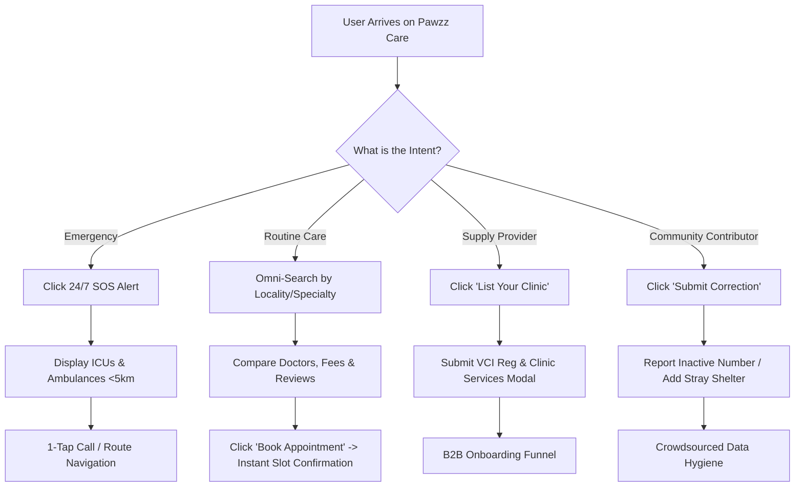

# Product Specification & UX Rationale: Pawzz Care (Practo for Animals)

**Candidate Assignment Deliverable — Part 1**  
**Role:** Product Development, Design & AI Systems Intern  
**Organization:** Pawzz Foundation (Founder: Akash Kumar)  
**Project:** Discovery & Care Platform for Domestic Pets and Stray Rescues  
**Live Prototype:** [index.html](file:///c:/Users/aksha/OneDrive/desktop/task22/task1-practo-for-animals/index.html)

---

## 1. Executive Summary & Problem Space

As an extension of **Pawzz Foundation's** groundbreaking work in street animal rescue, community care, and animal welfare, finding reliable, verified, and timely veterinary healthcare in India is broken and fragmented:
1. **The Emergency Dilemma:** When a pet or street animal suffers trauma, poisoning, or acute respiratory distress at 11:00 PM, pet parents scramble through outdated Google Maps listings, dialing dead numbers or finding clinics shut.
2. **Specialty Invisibility:** Animal care isn't one-size-fits-all. Birds, rabbits, and exotics require specialized avian/exotic vets; strays need NGOs with free or subsidized OPD and sterilization (ABC) capabilities; orthopedic traumas require dedicated diagnostic imaging and ICU setups.
3. **Supply-Side Fragmentation:** Independent veterinary doctors rely on word-of-mouth or expensive aggregators with hefty commission models, lacking a modern digital presence.

**Pawzz Care (Practo for Animals by Pawzz Foundation)** solves this by building a dual-sided discovery, triage, and booking engine with an empathetic, panic-friendly user experience.

---

## 2. Target User Personas

| Persona | Core Pain Point | Primary Motivation | Key Features Needed |
| :--- | :--- | :--- | :--- |
| **Panic-State Pet Parent** | Late-night trauma, dog ate rat poison or chocolate | Immediate triage, zero friction, verified phone number & ETA | 1-Tap SOS Emergency Mode, 24/7 ICU Filter, Direct Call, GPS Map |
| **Routine Pet Parent** | Annual vaccinations, dental cleaning, neutering | Doctor credibility, transparent fees, distance, cleanliness | Verified doctor degrees, reviews, slot booking, home visits |
| **Stray Animal Rescuer** | Hit-and-run indie pup, maggot wound, dehydrated cat | Free or subsidized care, ambulance transport, shelter admitting | "Stray & NGO" filter, ₹0 OPD badges, community triage protocols |
| **Veterinary Clinic Owner** | Empty daytime slots, marketing overhead | Verified patient leads, direct WhatsApp sync, zero commission | "List Your Business" onboarding, digital clinic profile |

---

## 3. Essential MVP Elements & Information Architecture

### A. The "Panic-Friendly" Emergency Mode (P0)
- In veterinary emergencies, cognitive load is high. The user cannot navigate multi-step drop-down menus.
- **Red Alert SOS Toggle:** One tap instantly overrides routine listings, prioritizing facilities with active 24/7 ICU, oxygen backup, and on-call trauma surgeons within a 5km radius.
- **Toll-Free Tele-Triage (1800-VET-SOS):** Direct fallback hotline for immediate first-aid instructions while en route.

### B. Smart Multi-Tiered Filters (P0)
1. **Category Triage:** All Services, Vet Clinics (OPD), 24/7 Multi-Specialty Hospitals, Pet Ambulances, Boarding & Daycare, Shelters & NGOs.
2. **Species Filter (Animal-Specific Matching):**
   - 🐕 Dogs
   - 🐈 Cats
   - 🦜 Birds & Exotics (critical differentiator; standard vets often refuse birds)
   - 🐾 Strays & Rescue Care
3. **Operational Filters:**
   - "Open Now" (real-time business hours logic)
   - "Home Visit Available" (for immobile elderly pets or trauma cases)
   - Sort by Proximity (Nearest first) vs Reputation (Rating 4.8+) vs Fee.

### C. Rich Provider Information Architecture (Card Layout)
Each listing card is structured to answer four fundamental questions in under 3 seconds:
1. **Who is treating?** Clinic name + Doctor name with VCI credentials (BVSc, MVSc Surgery) and years of experience.
2. **Is it open and verified?** Live status pill (`● OPEN NOW` vs `CLOSED`) + `Pawzz Verified` badge.
3. **How close and how much?** Exact locality, distance in km, and consultation fee (`₹500` or `FREE (NGO)`).
4. **How do I act immediately?**
   - `Call Now` (Direct `tel:` link)
   - `Directions` (One-tap Google Maps integration)
   - `Book Appointment` (Fast-track slot selection modal without upfront payment barrier)

---

## 4. Key CTAs & Conversion Strategy

The platform balances **demand-side conversion**, **supply-side acquisition**, and **community-driven data accuracy**:

### 1. "Find a Vet / Search" (Primary Demand CTA)
- Prominent dual-input search bar combining **Locality** + **Specialty/Symptom**.
- Auto-suggest prompts (e.g. *"Vomiting"*, *"Parvovirus"*, *"Vaccination"*).

### 2. "24/7 Emergency SOS" (High-Intent Life-Saving CTA)
- Positioned persistently in the top navigation bar with red accent and subtle pulse animation.
- Instant filtered view + emergency poison & first-aid guide modal.

### 3. "List Your Clinic / Practice" (Supply-Side Acquisition Loop)
- Zero-cost beta listing offer to eliminate B2B onboarding friction.
- Prompts for license verification (VCI registration) to maintain trust and credibility.

### 4. "Submit a Correction / Add Missing Shelter" (Network Effect & Data Integrity)
- In hyperlocal discovery, data decay is the #1 killer. Enabling pet lovers and rescuers to flag closed clinics or suggest unsung stray shelters creates an active community flywheel.

---

## 5. Mobile-First & Intuitive Design Principles

1. **Thumb-Zone Accessibility:** Bottom navigation and floating action buttons for primary interactions on mobile viewports.
2. **High-Contrast Emergency Accents:** Calming emerald green (`#059669`) for trust, health, and standard OPD; high-contrast crimson red (`#dc2626`) reserved exclusively for emergency actions.
3. **Zero Paywall Booking:** In Indian healthcare discovery, demanding upfront payment increases drop-off by over 65%. Pawzz Care adopts "Pay at Clinic" with SMS/WhatsApp confirmation.
4. **Dual View Architecture:** Instant switch between **List View** (content-rich comparison) and **Map View** (spatial proximity visualization).

---

## 6. Recommended Production Tech Stack

| Layer | Recommended Technology | Justification |
| :--- | :--- | :--- |
| **Frontend Framework** | **Next.js 15 (App Router) + Tailwind CSS** | Server-side rendering (SSR) for blazing SEO indexability on local searches (e.g., *"vet near me"*); responsive UI components. |
| **Search & Geolocation** | **Meilisearch / Algolia + PostGIS** | Sub-50ms typo-tolerant faceted search and geospatial proximity queries (`ST_DWithin`). |
| **Database & Auth** | **Supabase (PostgreSQL)** | Relational schemas for clinics, reviews, verified credentials, and real-time appointment bookings. |
| **Communication / Alerts** | **Twilio / Gupshup (WhatsApp Business API)** | Instant booking notifications, emergency doctor alerts, and reminder workflows. |
| **Mapping** | **Mapbox GL / Google Maps Platform** | Custom styling, emergency ambulance tracking, and distance matrix calculations. |
