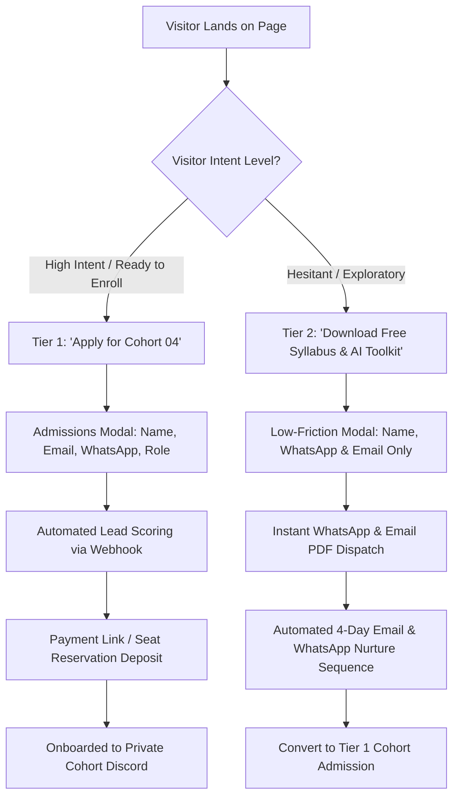

# Landing Page & Lead Funnel Strategy: Practical AI Systems Fellowship

**Candidate Assignment Deliverable — Part 2**  
**Role:** Product Development, Design & AI Systems Intern  
**Project:** AI Education & Digital Skills Programme Landing Page  
**Live Prototype:** [index.html](file:///c:/Users/aksha/OneDrive/desktop/task22/task2-ai-education-landing/index.html)

---

## 1. Core Value Proposition & Positioning

### The Market Context
The EdTech market is saturated with low-effort ₹499 pre-recorded courses teaching superficial ChatGPT prompt tricks (e.g., *"Act as a digital marketer"*). Students and young professionals suffer from course-completion fatigue and realize that generic certificates no longer impress recruiters or startup founders.

### The Differentiated Positioning
The **AIForge Practical Systems Fellowship** is positioned not as an academic course, but as a **Build-and-Ship Accelerator**:
> *"Stop memorizing AI prompts. Build autonomous AI workflows, multi-agent systems, and production MVPs that actually work."*

**Key Pillars:**
1. **Outcome-Obsessed:** Students graduate with **4 verifiable portfolio projects** (GitHub repos, live web apps, automated social pipelines).
2. **Modern Production Tooling:** Focus on **n8n, Claude 3.7 reasoning, tool calling, Supabase, and Cursor/v0** instead of basic text chat prompts.
3. **Cohort Scarcity & Founder Access:** Strictly capped at 30 seats per cohort to ensure 1-on-1 code reviews and direct founder mentorship.

---

## 2. Page Structure & Conversion Architecture

The landing page follows a high-converting **"Hook $\rightarrow$ Contrast $\rightarrow$ Proof $\rightarrow$ Curriculum $\rightarrow$ Risk-Reversal"** mental sequence:

```
┌─────────────────────────────────────────────────────────────┐
│ 1. Announcement Bar: Cohort 04 Scarcity (12 Seats Left)     │
├─────────────────────────────────────────────────────────────┤
│ 2. Hero Section: Outcome-driven Headline + Dual CTAs        │
├─────────────────────────────────────────────────────────────┤
│ 3. Social Proof & Trust Metrics: 4 Weeks, 4 Shipped MVPs    │
├─────────────────────────────────────────────────────────────┤
│ 4. "The Reality Check": Old Course Way vs Systems Way       │
├─────────────────────────────────────────────────────────────┤
│ 5. Interactive 4-Week Roadmap: Dynamic Module Tabs          │
├─────────────────────────────────────────────────────────────┤
│ 6. Proof of Work: 4 Real Projects Built Showcase            │
├─────────────────────────────────────────────────────────────┤
│ 7. Transparent Pricing: Student Grant vs Founder Pass       │
├─────────────────────────────────────────────────────────────┤
│ 8. Risk-Reversal: 7-Day 100% Money-Back Guarantee          │
├─────────────────────────────────────────────────────────────┤
│ 9. Interactive FAQ Accordion: Pre-empting Objections        │
├─────────────────────────────────────────────────────────────┤
│ 10. Sticky Mobile CTA Bar: Zero-scroll Conversion           │
└─────────────────────────────────────────────────────────────┘
```

---

## 3. CTA Strategy & The Two-Tier Funnel

To maximize conversion across different intent levels, the page utilizes a **Two-Tier Lead Capture Funnel**:



### A. High-Intent Primary CTA: "Apply Now & Reserve Seat"
- **Placement:** Hero section, floating top nav, pricing table, and final closing section.
- **Copy:** Specific and action-oriented (*"Apply Now & Reserve Seat (Early-Bird ₹1,999)"*).
- **Psychology:** Triggers urgency (seats filling) while keeping upfront financial commitment low (early-bird reservation).

### B. Low-Friction Secondary CTA: "Download Free Syllabus & 2025 AI Toolkit"
- **Placement:** Below hero headline and within weekly curriculum milestone cards.
- **Value Exchange:** The visitor exchanges their email and WhatsApp number for immediate tangible value:
  - 4-Week detailed lesson syllabus.
  - 15+ pre-built n8n and Make.com automation blueprints.
  - Curated 2025 AI Systems cheat sheet.
- **Conversion Impact:** Captures the 85% of traffic that isn't ready to purchase on first visit, feeding them into an automated nurture engine.

---

## 4. The Registration & Lead-Capture Journey

### Step 1: Capture
When a user submits either modal:
- Front-end validation prevents empty or invalid inputs.
- Payload captured: `full_name`, `email`, `whatsapp_phone`, `role_status`, `utm_source`, `timestamp`.

### Step 2: Instant Automated Fulfillment (Webhook Orchestration)
The form fires a webhook to an automation pipeline (Make.com or n8n):
1. **WhatsApp Cloud API Dispatch:** Sends an immediate welcome message containing the direct PDF download link for the syllabus.
2. **Email Dispatch (via Resend):** Formats a clean, professional welcome email with founder contact info and cohort schedule.
3. **CRM Sync (Airtable / Supabase):** Automatically categorizes the contact as `Status: Lead (Syllabus)` or `Status: Applicant (Pending Review)`.

### Step 3: Automated Nurture & Conversion Sequence
For leads who downloaded the syllabus:
- **Day 1:** Break down Project #1 (How to build an AI social carousel in 15 mins).
- **Day 2:** Student alumni case study (How an intern used these systems to land a full-time role).
- **Day 3:** Live Q&A invite with the founder.
- **Day 4:** Final Early-Bird discount expiration alert (generating FOMO and closing the sale).

---

## 5. Conversion Rate Optimization (CRO) Features

1. **Scarcity & Social Proof:** Cohort 04 seat count counter (*"12 Seats Left out of 30"*); alumni ratings (*"4.92 / 5.0"*).
2. **Interactive Tabbed Discovery:** Breaking down the 4-week roadmap into clickable tabs prevents cognitive overload and keeps session engagement high.
3. **Zero Risk Reversal:** Explicit 100% money-back guarantee prominently featured near pricing reduces purchase friction to zero.
4. **Mobile Sticky Bar:** Mobile visitors represent ~68% of Indian traffic; the sticky bottom bar ensures the conversion button is permanently accessible without scrolling.
