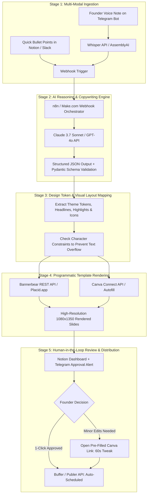

# Technical Architecture & Blueprint: AI-Powered Autonomous Content Creation System

**Candidate Assignment Deliverable — Part 3**  
**Role:** Product Development, Design & AI Systems Intern  
**Project:** Autonomous Instagram & LinkedIn Carousel Generation Pipeline  
**Live Interactive Simulator & Carousel:** [index.html](file:///c:/Users/aksha/OneDrive/desktop/task22/task3-content-automation/index.html)

---

## 1. Executive Summary & Objective

Founders often spend 10–15 hours weekly trapped in the "content creation tax": brainstorming angles, fighting Canva alignment grids, adjusting font sizes, and manually exporting PNGs. Hiring an agency or full-time graphic designer costs ₹35,000–₹60,000/month, introduces 24–48 hour communication lag, and dilutes the founder's authentic voice.

**The Solution:** An autonomous, modular 5-stage pipeline that converts a 60-second raw voice note or rough bullet points into an editable, branded, 7-slide carousel (1080x1350, 4:5 ratio) in under **90 seconds** at less than **₹5 ($0.06) per carousel**.

---

## 2. End-to-End System Architecture



---

## 3. Detailed 5-Stage Implementation Breakdown

### Stage 1: Frictionless Ingestion (Founder-Friendly Triggers)
Founders get ideas while driving, walking, or reading articles. They will not sit at a complex dashboard.
* **Option A (Voice First):** A private Telegram Bot (`@FounderContentBot`). The founder sends a voice memo. Whisper API transcribes it with punctuation in <4 seconds.
* **Option B (Text/Link First):** A "Quick Ideas" Notion database or Slack channel (`#social-ideas`).

### Stage 2: AI Reasoning & Copywriting Engine (Claude 3.7 Sonnet)
The raw transcript is fed into Claude 3.7 with a specialized system prompt enforcing a proven 7-slide viral retention framework:
1. **Slide 1 (The Scroll-Stopper):** High-contrast headline (<8 words), problem tag, clear swipe cue.
2. **Slide 2 (The Diagnosis):** Agitate the status quo with empathetic pain identification.
3. **Slide 3 (The System Architecture):** High-level 3-to-4 box framework.
4. **Slide 4 (Tactic 1):** Specific, actionable step with concise bullet points.
5. **Slide 5 (Tactic 2 / Pro Tip):** Counter-intuitive insight or code/prompt snippet.
6. **Slide 6 (The Concrete ROI):** Real metrics, time savings, or transformation proof.
7. **Slide 7 (The Conversation CTA):** Call-to-action incentivizing comments (*"Comment 'WORKFLOW' for the full n8n JSON"*).

### Stage 3: Programmatic Design Token Mapping
To prevent text from overlapping or looking clumsy, the system enforces **character limits per field**:
* `slide_headline`: Maximum 55 characters.
* `slide_body_bullet`: Maximum 45 characters per bullet (max 3 bullets).
* `emphasis_keywords`: Extracted for automatic color highlighting (e.g., `#6366f1` Indigo).

### Stage 4: Automated Template Rendering
* **Bannerbear API Integration:** Generates pixel-perfect PNGs in ~3 seconds via REST endpoint `POST /v2/images` using a master multi-page template.
* **Canva Connect API Integration:** If the founder prefers hands-on adjustments, the pipeline generates a live Canva design link pre-populated with all generated text and layout blocks.

### Stage 5: 60-Second Human-in-the-Loop Review & Multi-Channel Distribution
* An automated Telegram message pings the founder with carousel image thumbnails and two buttons:
  * `[ ✅ Approve & Schedule for 8:00 AM ]`
  * `[ ✏️ Edit in Canva ]`
* Upon approval, n8n triggers the **Buffer / Publer API** to publish the carousel PDF to LinkedIn and PNG carousel to Instagram with optimized hashtags and first comment.

---

## 4. Production-Ready System Prompts & JSON Schema

### A. The LLM System Prompt
```markdown
You are a World-Class Visual Content Strategist for Tech Founders. 
Your job is to transform raw founder ideas into high-retention 7-slide LinkedIn & Instagram carousels.

RULES:
1. Tone: Direct, punchy, tactical, zero fluff, zero generic corporate clichés.
2. Strictly enforce character limits to prevent visual text overflow.
3. Slide 1 must have an irresistible hook that challenges conventional wisdom.
4. Slide 7 must have an engagement loop CTA (e.g. asking for a keyword comment).
5. Output strictly valid JSON matching the provided schema.
```

### B. Output JSON Schema (Pydantic / TypeScript Interface)
```json
{
  "carousel_meta": {
    "topic": "The 4-Step Autonomous Content Engine",
    "target_platform": "LinkedIn and Instagram",
    "brand_palette": {
      "primary": "#4f46e5",
      "background": "#090d16",
      "text": "#ffffff",
      "accent": "#38bdf8"
    }
  },
  "linkedin_post_caption": "Founders don't need a $4,000/mo design agency...",
  "slides": [
    {
      "slide_number": 1,
      "slide_role": "HOOK_COVER",
      "tag": "FOUNDER PLAYBOOK",
      "headline": "How to Build an AI Content Engine That Runs on Autopilot",
      "subheadline": "The exact 4-layer automation pipeline to produce high-impact carousels in 90s.",
      "swipe_prompt": "Swipe ➔"
    },
    {
      "slide_number": 2,
      "slide_role": "PROBLEM_DIAGNOSIS",
      "tag": "THE MANUAL TAX",
      "headline": "Why Founders Abandon Visual Content After 3 Weeks",
      "bullets": [
        "Writing copy takes 45 mins",
        "Aligning Canva boxes takes 90 mins",
        "Total: 2.5 hrs wasted per post"
      ]
    }
  ]
}
```

---

## 5. Cost & Operational Economics

| Metric | Traditional Freelancer / Agency | In-House Junior Designer | Our AI Systems Pipeline |
| :--- | :--- | :--- | :--- |
| **Monthly Cost** | ₹35,000 – ₹60,000 | ₹25,000 – ₹40,000 | **~₹1,200 ($15)** (API usage) |
| **Turnaround Time** | 24 – 48 Hours | 8 – 24 Hours | **90 Seconds** |
| **Iteration Friction** | 3 rounds of slack feedback | High context fatigue | **Instant re-generation** |
| **Publishing Capacity** | 2–3 posts / week max | 3–4 posts / week max | **Daily / On-Demand** |
| **Brand Consistency** | Deviates between designers | Requires constant review | **100% Locked Design Tokens** |
